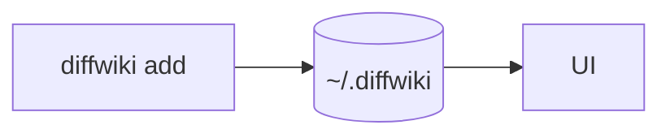

# Introduction to diffwiki

Welcome to diffwiki — your local, git-friendly knowledge base.

```ts
import { listCollections } from 'diffwiki-core';

const cols = await listCollections();
console.log(cols.map((c) => c.name));
```


