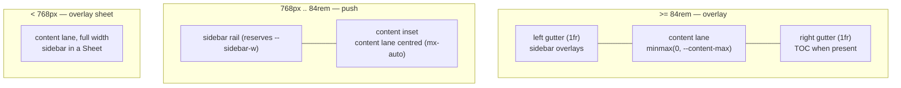

# App Shell & Layout

<!-- Component type: frontend -->
<!-- Path: apps/wiki/src/components/{app-shell,page-layout,ui/sidebar}.tsx -->

## Overview

The app shell is the persistent chrome of the wiki app — a full-width top bar, a left collection sidebar, and the content inset — plus the page layout that positions the content lane, its gutters, and the optional table of contents (TOC). It exists so every route (home, article, listing, search) shares one responsive frame with a single, predictable rule for where content sits at each screen size. Without it, each page would re-implement gutters and the sidebar/TOC relationship and drift apart.

## Requirements

- The content lane must always be centred with **symmetric left/right gutters** at every breakpoint.
- Three responsive layouts, applied to **every** page regardless of whether it has a TOC:
  - **Mobile**: the sidebar is an overlay sheet; narrow gutters.
  - **Tablet**: the sidebar is an inline rail that **pushes** content (a layout shift), reflowing to fill when collapsed; medium gutters.
  - **Desktop**: the sidebar **overlays** the left gutter (it does not push); left gutter == right gutter.
- The TOC must **not** be a separate layout — it only occupies the right gutter on desktop when that gutter is wide enough; it must never displace the content lane, so a page with a TOC and one without lay out identically.
- Layout must be expressed in **Tailwind utilities with `cn()`**, not hand-written `@media` rules in `styles.css`.

## Design

### Why the tablet→desktop switch exists

The sidebar and TOC are 16rem (`--sidebar-w` / `--toc-w`) and the content lane is 48rem (`--content-max`). For the sidebar to "slide over" the left gutter without covering content, that gutter must be at least as wide as the sidebar. The gutter is `(viewport − content-lane) / 2`, so overlay is only possible once the viewport is wide enough — about `content-max + 2 × sidebar-w` ≈ **84rem (1344px)**. Below that, the gutters are too thin, so the rail pushes content instead (the tablet "layout shift"). This is why one breakpoint governs the switch.

### One rule, TOC-independent

The content lane centres in the viewport at desktop via a 3-column grid `[1fr | content | 1fr]`: the equal `1fr` gutters keep the lane centred, the fixed sidebar overlays the left gutter, and the TOC (when present) lives in the right gutter cell. Because the TOC has its own cell, adding or removing it never moves the lane.



### Encapsulation

The responsive logic lives in two places only: the Sidebar primitive controls the push-vs-overlay regime (via the sidebar-gap width), and `PageLayout` owns the content lane, gutters, and TOC placement. Routes just render `<PageLayout aside={...}>`; they never touch gutters or breakpoints.

## Implementation

### Component Tree

```
AppShell (SidebarProvider, flex-col)
├─ TopNav                     full-width sticky bar (sidebar trigger, breadcrumbs, theme, GitHub)
└─ div.flex (row)
   ├─ AppSidebar (Sidebar)    fixed rail / push gap / mobile Sheet
   │  └─ NavTree              collection tree (+ external-collection git badges)
   └─ SidebarInset            content area
      └─ <route> → PageLayout
         ├─ content lane      mx-auto max-w-(--content-max), always centred
         └─ aside (TOC)       right-gutter cell, desktop only, sticky
```

### Key mechanisms

- **Sidebar regime** (`components/ui/sidebar.tsx`): the `[data-slot='sidebar-gap']` element reserves `--sidebar-width` (push) but is forced to `min-[84rem]:w-0!` at desktop, so content centres in the full viewport while the fixed container stays at `left-0`, overlaying the left gutter. The container is offset below the top bar with `top-(--nav-h) bottom-auto h-[calc(100svh-var(--nav-h))]`.
- **Content + gutters** (`components/page-layout.tsx`): below `84rem` the lane is `mx-auto max-w-[var(--content-max)]` (centred in the inset); at `min-[84rem]` a `grid-cols-[1fr_minmax(0,var(--content-max))_1fr]` gives equal gutters with the TOC in the right cell.
- **Mobile** is the shadcn default (`md:block` hides the rail below 768px; a Sheet takes over) — no custom code.

### Layout tokens & breakpoint

| Token / breakpoint | Value              | Controls                                       |
| ------------------ | ------------------ | ---------------------------------------------- |
| `--nav-h`          | `3.5rem`           | Top bar height; sidebar/TOC top offset.        |
| `--sidebar-w`      | `16rem`            | Sidebar rail width.                            |
| `--toc-w`          | `16rem`            | TOC width in the right gutter.                 |
| `--content-max`    | `48rem`            | Content lane max width.                        |
| mobile breakpoint  | `768px` (`md`)     | Sheet ↔ inline rail (`use-mobile.ts`).         |
| desktop breakpoint | `84rem` (`1344px`) | Push ↔ overlay; TOC show/hide (`min-[84rem]`). |

## References

- `apps/wiki/src/components/page-layout.tsx` — content lane, gutters, TOC placement.
- `apps/wiki/src/components/app-shell.tsx` — top bar + sidebar + inset composition.
- `apps/wiki/src/components/ui/sidebar.tsx` — the sidebar-gap/container regime (push vs overlay).
- `apps/wiki/src/hooks/use-mobile.ts` — the 768px mobile breakpoint.
- [`docs/architecture/static-site-generation.md`](static-site-generation.md) — how the shell behaves in a static export.
