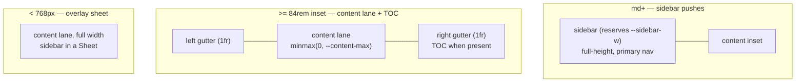

# App Shell & Layout

<!-- Component type: frontend -->
<!-- Path: apps/wiki/src/components/{app-shell,page-layout,ui/sidebar}.tsx -->

## Overview

The app shell is the persistent chrome of the wiki app — a full-height left navigation sidebar (logo, search, collection tree, settings + GitHub) and, in the content column to its right, a slim top bar (sidebar trigger, breadcrumbs, page audience/status) above the content inset — plus the page layout that positions the content lane, its gutters, and the optional table of contents (TOC). It exists so every route (home, article, listing, search) shares one responsive frame with a single, predictable rule for where content sits at each screen size. Without it, each page would re-implement gutters and the sidebar/TOC relationship and drift apart.

## Requirements

- The content lane must always be centred with **symmetric left/right gutters** at every breakpoint.
- Three responsive layouts, applied to **every** page regardless of whether it has a TOC:
  - **Mobile**: the sidebar is an overlay sheet; narrow gutters.
  - **Tablet/Desktop** (`md+`): the sidebar is an inline, full-height left column that **pushes** content (the content lane starts at the sidebar's right edge), reflowing to fill when collapsed. The sidebar is the outermost, primary-navigation column and is never overlaid by the top nav.
- The TOC must **not** be a separate layout — it only occupies the right gutter on desktop when that gutter is wide enough; it must never displace the content lane, so a page with a TOC and one without lay out identically.
- Layout must be expressed in **Tailwind utilities with `cn()`**, not hand-written `@media` rules in `styles.css`.

## Design

### The sidebar always pushes

The sidebar is the outermost, full-height primary-navigation column, so at every `md+`
width it **pushes** the content inset (the content lane begins at the sidebar's right
edge) — it is never overlaid by the top nav. The `84rem` breakpoint no longer switches
push↔overlay; it only governs whether the content inset shows the TOC in its right
gutter (below `84rem` there is no room, above it there is).

### One rule, TOC-independent

Within the content inset the content lane centres via a 3-column grid `[1fr | content | 1fr]`
at desktop: the equal `1fr` gutters keep the lane centred **inside the inset**, and the
TOC (when present) lives in the right gutter cell. Because the TOC has its own cell,
adding or removing it never moves the lane.



### Encapsulation

The responsive logic lives in two places only: the Sidebar primitive controls the push regime (via the sidebar-gap width, which reserves `--sidebar-width` at all `md+` widths), and `PageLayout` owns the content lane, gutters, and TOC placement. Routes just render `<PageLayout aside={...}>`; they never touch gutters or breakpoints.

## Implementation

### Component Tree

```
AppShell (SidebarProvider, row)
├─ AppSidebar (Sidebar)        full-height left column — PRIMARY NAV
│  ├─ SidebarHeader            logo/wordmark home link + Search button (⌘K → /search)
│  ├─ SidebarContent → NavTree collection tree (+ external-collection git badges)
│  └─ SidebarFooter            settings dialog + GitHub link
└─ SidebarInset                content column
   ├─ TopNav                   sticky bar: sidebar trigger, breadcrumbs (md+), page audience/status (far right)
   └─ <route> → PageLayout
      ├─ content lane          mx-auto max-w-(--content-max), always centred
      └─ aside (TOC)           right-gutter cell, desktop only, sticky
```

### Key mechanisms

- **Sidebar regime** (`components/ui/sidebar.tsx`): the `[data-slot='sidebar-gap']` element reserves `--sidebar-width` at all `md+` widths (push) and reflows to `0` only when the sidebar is collapsed, so the content inset always begins at the sidebar's right edge — the top nav never spans over the sidebar. The sidebar is the outermost column and the primary navigation surface, so the fixed container spans the full viewport height (`inset-y-0 h-svh`) rather than starting below the top bar.
- **Content + gutters** (`components/page-layout.tsx`): the lane is `mx-auto max-w-[var(--content-max)]`, centred within the content inset (never under the sidebar); at `min-[84rem]` a `grid-cols-[1fr_minmax(0,var(--content-max))_1fr]` gives equal gutters inside the inset with the TOC in the right cell.
- **Mobile** is the shadcn default (`md:block` hides the rail below 768px; a Sheet takes over) — no custom code.
- **DOM hierarchy** (`components/app-shell.tsx`): the `SidebarProvider` lays out as a row; `AppSidebar` is the first column and the `TopNav` renders inside `SidebarInset` (the content column), sticky at `top-0`. The top nav therefore no longer spans the full width above the sidebar — the sidebar sits higher in the DOM as primary navigation.

### Layout tokens & breakpoint

| Token / breakpoint | Value              | Controls                                        |
| ------------------ | ------------------ | ----------------------------------------------- |
| `--nav-h`          | `3.5rem`           | Top bar height; sidebar/TOC top offset.         |
| `--sidebar-w`      | `16rem`            | Sidebar rail width.                             |
| `--toc-w`          | `16rem`            | TOC width in the right gutter.                  |
| `--content-max`    | `48rem`            | Content lane max width.                         |
| mobile breakpoint  | `768px` (`md`)     | Sheet ↔ inline rail (`use-mobile.ts`).          |
| desktop breakpoint | `84rem` (`1344px`) | TOC show/hide inside the inset (`min-[84rem]`). |

## References

- `apps/wiki/src/components/page-layout.tsx` — content lane, gutters, TOC placement.
- `apps/wiki/src/components/app-shell.tsx` — top bar + sidebar + inset composition.
- `apps/wiki/src/components/ui/sidebar.tsx` — the sidebar-gap/container push regime.
- `apps/wiki/src/hooks/use-mobile.ts` — the 768px mobile breakpoint.
- [`docs/architecture/static-site-generation.md`](static-site-generation.md) — how the shell behaves in a static export.
