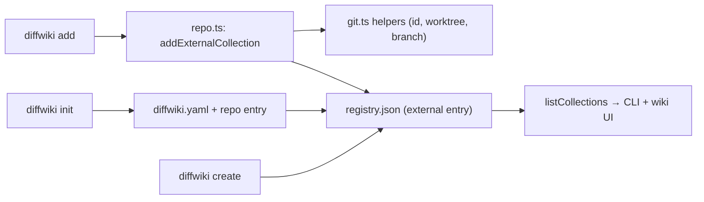

# Collections

<!-- Component type: library -->
<!-- Path: packages/diffwiki-core/src/{collections,repo,git,registry}.ts -->

## Overview

A collection is the primary organisational unit in diffwiki: a named directory of markdown notes tracked in a central registry so every tool can discover it. Collections come in three kinds, from fully diffwiki-managed to a zero-config attachment of an existing repository's documentation folder. The registry is what lets the command-line interface (CLI) and the browser interface share one source of truth about where notes live.

## Requirements

- Every collection must be recorded in the registry with a name, type, and content path, and must be resolvable back to a directory on disk.
- Adding an existing repository (`diffwiki add`) must require no configuration file — it must infer the title, content directory, and a stable identity automatically.
- A repository must be addable only once: a second attempt on the same repository must be rejected.
- Adding must be refused from a linked git worktree — only the primary checkout is accepted.
- A non-git directory must be initialised as a repository before it is added.

## Design

### Three collection types

`CollectionEntry` (`packages/diffwiki-core/src/types.ts`) carries a `type` discriminant. Each type differs in who owns the storage and whether a `diffwiki.yaml` is written:

| Type | Created by | Storage |
|------|-----------|---------|
| `global` | `diffwiki create <name>` | `~/.diffwiki/collections/<name>/` (diffwiki-owned) |
| `repo` | `diffwiki init` (inside a git repo) | Any path in the repo; a `diffwiki.yaml` at the repo root records it |
| `external` | `diffwiki add` (inside any git repo) | `<repoRoot>/<docsDir>/`; no `diffwiki.yaml` |

All entries live in `~/.diffwiki/registry.json` and are read by `listCollections`.

### Stable, location-independent identity

External collections are keyed by a repository identity that survives cloning and worktrees, so the same repository is never registered twice under different paths. The identity is the root-commit hash, falling back to the normalised `origin` URL, then the absolute path — the first stable signal available. This is why `diffwiki add` can reject a duplicate even when run from a different checkout of the same repository.

### `add` versus `init`

`diffwiki add` is the zero-config path: it infers everything. `diffwiki init` is the override path: it writes a `diffwiki.yaml` you can edit to customise the collection name or point at a specific directory. The two are complementary entry points to the same registry.

## Implementation

### Public API Surface

| Export | Location | Role |
|--------|----------|------|
| `addExternalCollection(dir, opts)` | `repo.ts` | Registers the current repo as an `external` collection (flow below). |
| `findCollectionById(id)` | `collections.ts` | Registry lookup by stable repo id — the duplicate check. |
| `collectionGitStatus(entry)` | `repo.ts` | Branch + ahead/behind for external collections (else `null`). |
| `gitToplevel` / `isLinkedWorktree` / `repoId` / `gitBranch` / `gitUpstreamStatus` / `ensureGitRepo` | `git.ts` | Low-level git helpers backing the above. |

### `addExternalCollection` flow

1. Detects linked worktrees — compares `--absolute-git-dir` with `--git-common-dir`; if they differ it refuses with `WorktreeNotAllowedError`.
2. Auto-initialises git — runs `git init` when the directory is not yet a repository.
3. Computes a stable repo id — root-commit hash, else normalised `origin` URL, else absolute path.
4. Enforces uniqueness — `findCollectionById` rejects a matching id with `CollectionAlreadyAddedError`.
5. Derives the title — the `origin` URL's last path segment (without `.git`), else the repo directory name.
6. Registers the entry — an `external` entry with `id`, `repoRoot`, and `docsDir` (default `docs`, overridable with `-d`); the stored `path` is `<repoRoot>/<docsDir>`.

### Git status in the sidebar

`collectionGitStatus` runs `gitBranch` and `gitUpstreamStatus` for external collections; the result is attached to `CollectionInfo` by the `site.ts` builders and shown in the sidebar as a branch badge and a `↓N` behind-indicator. During static export (`DIFFWIKI_STATIC=1`) these calls are skipped and a `console.warn` is emitted per affected collection, since the static bundle has no access to live git state.

### Error types

| Error class | Thrown when |
|-------------|-------------|
| `WorktreeNotAllowedError` | `diffwiki add` is run inside a linked git worktree |
| `CollectionAlreadyAddedError` | The repository is already registered (same `id`) |
| `CollectionNotFoundError` | A referenced collection name is not in the registry |

## References

- `packages/diffwiki-core/src/repo.ts` — `addExternalCollection`, `collectionGitStatus`, `init`.
- `packages/diffwiki-core/src/git.ts` — git identity, branch, and worktree helpers.
- `packages/diffwiki-core/src/registry.ts` — registry read/write.
- [`docs/architecture/static-site-generation.md`](static-site-generation.md) — how collections are enumerated during export.
- [`docs/architecture.md`](../architecture.md) — the monorepo and registry overview.
