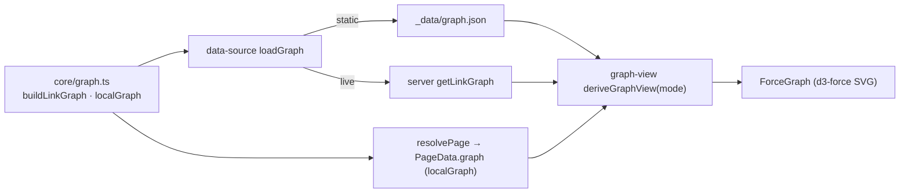

# Knowledge Graph

<!-- Component type: library + feature -->
<!-- Path: packages/diffwiki-core/src/graph.ts + apps/wiki/src/components/{force-graph,graph-overlay,knowledge-graph}.tsx + apps/wiki/src/lib/graph-view.ts -->

## Overview

An Obsidian-style knowledge graph sits in the right sidebar of every wiki page (above the TOC) as a small neighbourhood preview, and expands to a full-screen overlay of the whole wiki. Nodes are articles; edges are the internal links between them. Tags add a second layer of structure — either as their own hub nodes or as an invisible force that pulls related pages together. The same graph model and renderer serve both the live server and the exported static site, so the graph looks and behaves identically in either build.

## Requirements

- Extract the internal links of every article into one whole-wiki graph, and slice a per-page neighbourhood for the sidebar preview.
- Resolve links the way the app routes them: absolute route links (`/coll/slug`), relative file links (`./sub`, `../x`), and links from folder/collection **index pages** (resolved against the folder). Drop dead, external, and self links; collapse duplicates.
- Connect pages that share tags, offered as two views: links-only (tags affect layout only) and tag hubs (tags as nodes).
- Work in both modes without forking logic: dynamic (server function) and static (prebuilt `_data/graph.json` + per-page previews), including subset exports.
- Render client-side without `eval` (CSP-safe), framed on the current article, with readable labels and controls that don't overwhelm a large graph.

## Design

### One model, two data sources

`packages/diffwiki-core/src/graph.ts` builds the model. `buildLinkGraph` walks every collection, adds one node per article — **including folder and collection index pages** — and one directed edge per resolved internal link, then adds tag-hub nodes (`tag:<name>`) with an article→hub edge per tag. It memoises the whole-wiki graph per process. `localGraph` slices the neighbourhood of one page: its link neighbours, its tag hubs, and its **2-hop co-tagged siblings** (so the links-only view still has neighbours to pull closer). Link resolution is shared with the render pipeline via `renderArticle`'s `rehypeCollectLinks` — the graph never parses markdown itself.

Both runtimes feed the same model through one seam (`apps/wiki/src/lib/data-source.ts`): the overlay's whole-wiki graph loads via `loadGraph` (server fn `getLinkGraph` live, `_data/graph.json` static), and each page's sidebar preview is the `localGraph` embedded in `resolvePage`'s `PageData`. On a subset export (`--filter`/`--exclude`) both the overlay `graph.json` and every page's `localGraph` are pruned to the same included-collection set, so a preview never links to a page that was excluded from the build (which would 404 on click).

### View modes (client projection)

The base graph carries both link and tag edges; `apps/wiki/src/lib/graph-view.ts`'s `deriveGraphView` projects it to what the UI draws, so switching modes never refetches:

- **Links** (default) — draw only hyperlink edges; shared tags become *force-only* edges (they pull co-tagged pages together but aren't drawn).
- **Tags** — draw the tag-hub nodes and the article→hub membership edges.



### Rendering

`ForceGraph` is presentational: it runs a d3-force simulation that is **dynamically imported** (never in the SSR/initial bundle) and builds the SVG itself, so there is no `eval`. The view auto-fits centred on the current article, zoom is pointer-anchored, node size is capped so nodes don't balloon when zoomed in, and labels render in a non-scaled layer (constant screen size, only the active/hovered node until you zoom in past a threshold). Colours are read at runtime from theme CSS tokens, so light/dark just work.

## Implementation

### Public API Surface

| Export | Location | Role |
|--------|----------|------|
| `buildLinkGraph()` / `invalidateLinkGraph()` | `packages/diffwiki-core/src/graph.ts` | Build (memoised) / clear the whole-wiki `LinkGraph`. |
| `localGraph(graph, focusId, include?, siblingCap?)` | `graph.ts` | Slice a page's neighbourhood (link + tag + 2-hop co-tagged siblings), collection-filtered for subset exports. |
| `GraphNode` / `GraphEdge` / `LinkGraph` / `LocalGraph` | `packages/diffwiki-core/src/types.ts` | Node = article or `tag` hub; edge kind = `link` or `tag`. |
| `deriveGraphView(graph, mode)` / `GraphMode` | `apps/wiki/src/lib/graph-view.ts` | Project the base graph to the drawn view for `proximity`/`hubs`. |
| `loadGraph` | `apps/wiki/src/lib/data-source.ts` | Build-time-switched whole-wiki graph source (server fn vs `graph.json`). |
| `ForceGraph` | `apps/wiki/src/components/force-graph.tsx` | Presentational d3-force SVG renderer. |
| `GraphOverlay` | `apps/wiki/src/components/graph-overlay.tsx` | Full-screen Radix dialog: mode toggle, recenter, close. |
| `KnowledgeGraph` | `apps/wiki/src/components/knowledge-graph.tsx` | Sidebar preview + expand control; owns the persisted view mode. |

Node shape:

```ts
interface GraphNode {
  id: string;                    // "coll/slug" for an article, "tag:<name>" for a hub
  kind: 'article' | 'tag';
  coll: string;                  // empty for a tag hub
  slug: string;                  // empty for a tag hub
  title: string;                 // "#<name>" for a hub
}
interface GraphEdge {
  source: string;
  target: string;
  kind: 'link' | 'tag';          // hyperlink vs article↔tag-hub membership
}
```

### Known limitation

`buildLinkGraph` memoises on the process only; the dynamic server function never invalidates, so a long-lived dev/prod server serves the graph built at first request until restart (flagged as `TODO(live-reload)` in `graph.ts`).

## References

- `packages/diffwiki-core/src/graph.ts` — graph model (`buildLinkGraph`, `localGraph`).
- `packages/diffwiki-core/src/render.ts` — `rehypeCollectLinks` / `resolveHref`, the shared link resolver.
- `apps/wiki/src/lib/graph-view.ts` — the client-side view projection and modes.
- `apps/wiki/src/components/force-graph.tsx` — the d3-force SVG renderer.
- [`docs/architecture/static-site-generation.md`](static-site-generation.md) — how `graph.json` and per-doc previews are emitted during export.
