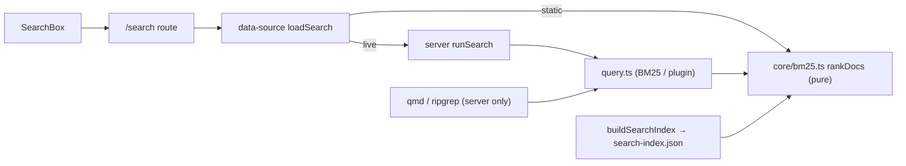

# Search

<!-- Component type: library -->
<!-- Path: packages/diffwiki-core/src/{bm25,query,search}.ts + apps/wiki/src/components/search-box.tsx -->

## Overview

Search finds articles across every collection, ranked by relevance. One BM25 (Best Matching 25) ranking implementation serves three runtimes — the command-line interface (CLI), the live web app, and the exported static site — so results are consistent everywhere and the algorithm never forks. The live app can additionally route to subprocess plugin engines (keyword via ripgrep, semantic/hybrid via qmd); those need a server, so the static site uses the built-in BM25 alone.

## Requirements

- Must rank articles by relevance over title, tags, collection, and body (not a bare substring match), case-insensitively.
- One ranking implementation must be shared by the CLI, the live app, and the static site — no divergent copies.
- Static-site search must run entirely in the browser (no server), yet produce the same BM25 ranking as the server's native search.
- The live app must be free to use richer plugin engines when configured, falling back to native BM25 when a plugin is unavailable.
- Selecting a result must navigate to that article's route.

## Design

### One scorer, three runtimes

The BM25 scorer lives in `packages/diffwiki-core/src/bm25.ts` and has **zero Node/filesystem imports**, so the identical `rankDocs` runs on the server and in the browser. It is exposed browser-side through the `diffwiki-core/bm25` subpath export, keeping Node-only core code out of the client bundle. This is what lets the static site rank exactly like the live app instead of degrading to a weaker substring match.

### Server vs. static data source

The scorer needs pre-tokenized documents. On the server, `nativeSearch` reads collection files at query time and tokenizes them. For the static site the exporter runs `buildSearchIndex` once at build time — the same tokenization — and ships the result as `search-index.json`; the browser fetches it and ranks in memory. Plugin engines (qmd/ripgrep) are server-only and are simply absent statically.



## Implementation

### Public API Surface

| Export | Location | Role |
|--------|----------|------|
| `rankDocs` / `tokenize` | `packages/diffwiki-core/src/bm25.ts` (+ `diffwiki-core/bm25` subpath) | Pure BM25 ranking over pre-tokenized docs; shared by every runtime. |
| `SearchDoc` / `RankableFields` | `bm25.ts` | The serialisable index document: routing metadata + tokenized fields. |
| `nativeSearch` / `search` / `query` | `packages/diffwiki-core/src/query.ts` | Server search: engine routing (native BM25 → plugin) + file-reading native search. |
| `buildSearchIndex()` | `packages/diffwiki-core/src/search.ts` | Builds `SearchDoc[]` (tokenized fields incl. body) for the exporter. |
| `loadSearch` / `loadSearchModes` | `apps/wiki/src/lib/data-source.ts` | Build-time-switched: server `runSearch`/`getSearchModes` live, or client `rankDocs` over the static index. |
| `SearchBox` | `apps/wiki/src/components/search-box.tsx` | The search input; always submits to `/search?q=…` (live and static). |
| `/search` route | `apps/wiki/src/routes/search.tsx` | The results page (query bar, collection filter, mode dropdown, ranked hits). |

`SearchDoc` (written to `search-index.json`):

```ts
interface SearchDoc {
  collection: string;
  slug: string;                 // article route slug, e.g. "guide/setup"
  title: string;
  tags: string[];
  fields: {                     // pre-tokenized, what BM25 ranks (weighted title×3, tags×2, collection×1.5, body×1)
    title: string[];
    tags: string[];
    collection: string[];
    body: string[];
  };
}
```

### The /search page — one UI, two data sources

`SearchBox` behaves identically live and static: it submits to `/search?q=…`. The `/search` route (`routes/search.tsx`) renders the query bar, collection filter, mode dropdown, and ranked results the same way in both builds — only its data source differs, via `data-source`:

1. **Live** — the route loader calls the server `runSearch`, which runs the resolved engine (native BM25 or a plugin) and server-renders the results.
2. **Static** — there is no server, so the component runs `loadSearch` on the client (fetching `search-index.json` once, memoised, then ranking with the shared `rankDocs`). The plugin-mode dropdown is hidden (native BM25 only); the collection filter still works.

Because query strings vary, the exporter prerenders `/search` as an empty shell (following the router's `/search` → `/search?q=` redirect), and the component computes results client-side on both in-app navigation and a direct load of `/search?q=…`.

### Environment Variables / Configuration

| Variable | Description | Required |
|----------|-------------|----------|
| `VITE_DIFFWIKI_STATIC` | Set to `1` at build time to switch the `/search` data source to the client-side BM25 branch (over `search-index.json`). | no (default: live server search) |

## References

- `packages/diffwiki-core/src/bm25.ts` — the shared, browser-safe BM25 scorer.
- `packages/diffwiki-core/src/query.ts` — server engine routing + native search.
- `packages/diffwiki-core/src/search.ts` — `buildSearchIndex`.
- `apps/wiki/src/components/search-box.tsx` — the live/static search input.
- [`docs/search.md`](../search.md) — engine routing, native BM25, qmd, ripgrep, and the web search route in depth.
- [`docs/architecture/static-site-generation.md`](static-site-generation.md) — how the index is emitted during export.
