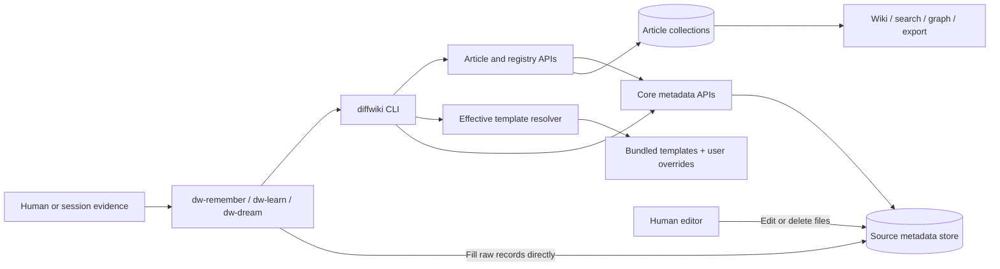
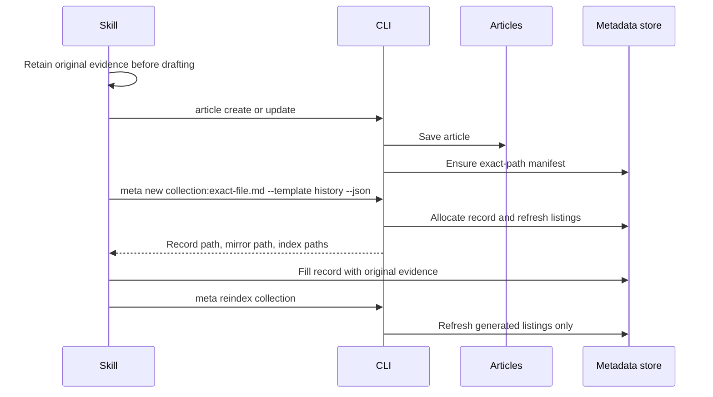
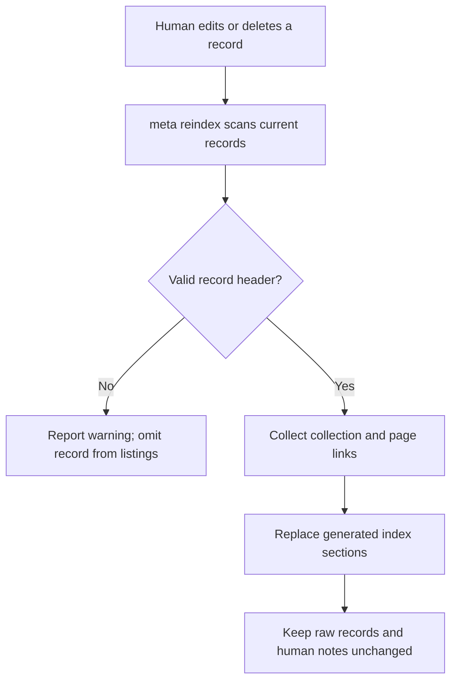

# Source metadata and provenance — software architecture

## Overview

Keep the original evidence behind wiki pages: user requests, session outputs,
source code, and extracts from external documents. Humans and skills can inspect
and edit these files without rebuilding an article. The CLI allocates files and
updates indexes; skills capture evidence and write article drafts.

This feature does not add a metadata viewer, automatic web fetching, pruning
rules, review states, or a promise that a deleted learning cannot be recreated.

## Requirement

### Functional

- Mirror each collection and exact article filename, including `index.md`,
  `README.md`, nested paths, and MDX files.
- Store collection-wide sources and sources attached to one article.
- Provide `history`, `external-source-extract`, and `dream-learning` templates.
- Index all records, with dream learnings listed separately for easy inspection.
- Reflect manual record edits and deletions when the user runs `meta reindex`.
- Keep source metadata outside article navigation, search, graphs, lint, and exports.

### Non-Functional

- Preserve raw record bytes, code whitespace, human notes, and unknown fields.
- Keep exact quotes distinct from generated claims. Missing evidence stays unknown.
- Reject traversal, metadata symlinks, and overlapping article/metadata roots.
- Retain a saved article or record if a later metadata update fails; report repair steps.
- Allow user templates to override bundled defaults without being overwritten.

## Design

### Components and Responsibilities



- `meta.ts` owns mirrors, record allocation, and generated indexes. It accepts
  resolved collection entries, so it does not import the registry.
- Article writes create empty source manifests. They do not invent source evidence.
- Skills fill records with exact requests, role-labeled outputs, snippets, and locators.
- Readers continue to walk article collections, not the metadata store.

### Data and Control Flow

Article creation and evidence capture are separate writes. Creating an article
ensures its manifest exists; adding metadata does not create or rewrite an article.



`dw-learn` carries raw evidence through mining into drafts. Session/history inputs
also live in a hidden `transcripts` article collection; those articles and the raw
metadata store serve different purposes. A custom transcript summary never replaces
the original evidence packet. `dw-dream` reads original evidence before maintenance
and writes one small `dream-learning` record for each actual change. No-op runs write
no learning. Dry runs write proposals only.

All metadata lives under `${DIFFWIKI_HOME:-~/.diffwiki}/meta`, even when an article
collection lives in an external repository. Back up this tree separately from repo files.

```text
~/.diffwiki/
├── collections/notes/guide/setup.mdx      # example article
├── templates/*-template.md               # optional user overrides
└── meta/
    ├── META.md                          # all source collections
    └── notes/
        ├── guide/setup.mdx              # exact-path source manifest, not article copy
        └── .meta/
            ├── META.md                  # raw sources, dream learnings, page links
            ├── records/
            │   └── <UTC-time>-<random>.md
            └── attachments/<record-id>/ # optional convention; user-managed files
```

### Interfaces and Contracts

```sh
diffwiki meta init [collection] [--json]
diffwiki meta new <collection[:exact-file.md]> --template <kind> [--json]
diffwiki meta reindex [collection] [--json]
diffwiki templates list --category article|meta|all --json
```

`meta init` inventories actual Markdown/MDX files, including drafts and hidden
audiences. Repeated runs keep existing files. `meta new` accepts a collection alone
or an existing exact relative article file; it does not slugify that filename.
`meta reindex` reads retained metadata collections even after article removal or
collection unregistration.

```yaml
---
kind: history                 # or external-source-extract / dream-learning
collection: notes
article_path: guide/setup.mdx  # omit for collection-wide sources
captured_at: "2026-10-20T12:00:00.000Z"
---
# Template body filled with evidence
```

```ts
// meta new --json
{ id, path, target, mirror_path?, index_paths }
// meta init / meta reindex --json
{ created, kept, index_paths, warnings, errors }
```

Each record has one optional article target. The collection index links all its
records; a page manifest links its own records and the collection index. Other
pages can cite a shared collection record without copying it.

## Implementation

### Templates and evidence

| Kind | Evidence to capture |
|---|---|
| `history` | Near-verbatim user instructions, rationale, role-labeled session output, commands/results, code snippets, and source locations. |
| `external-source-extract` | URL, source metadata, capture time, exact static excerpts, and any missing or redacted material. |
| `dream-learning` | The maintenance change, original requests/outputs/snippets, and links to the evidence that caused it. |

The template resolver merges user overrides over bundled files by filename.
Metadata templates carry `category: meta` and stay out of the default article
shape list. The CLI strips template discovery fields before writing a record header.
Skills use the effective path returned by `templates list`, not a guessed bundled path.

Keep source times/locations, unknown fields, redaction markers, and code whitespace.
External captures preserve what was actually retrieved, not an implied full archive.
Assistant claims cannot establish facts or user preferences. Article references use
original URLs or file/session locators, not private metadata paths or placeholders.

### Index updates and recovery



Only regions between `<!-- diffwiki:meta:start -->` and
`<!-- diffwiki:meta:end -->` are generated. Index files use temporary-file rename;
new records use exclusive creation. These are separate filesystem writes, not a
transaction or locking protocol. A missing generated section is appended; incomplete
markers report an error. Malformed records and missing manifests produce warnings.

If an article save succeeds but its manifest fails, the error names the saved
article and suggests `meta init <collection>`. If record allocation succeeds but
indexing fails, the record stays on disk and the error suggests
`meta reindex <collection>`. Users repair the file conflict and retry the index step.

Deleting articles does not delete evidence. Users prune learnings by editing or
deleting files and reindexing; no code tracks dismissal or prevents later recreation.
Preview/export registry seeding creates no persistent metadata.

## References

- [Core metadata implementation](../../packages/diffwiki-core/src/meta.ts)
- [CLI commands](../../packages/diffwiki-cli/src/cli.ts)
- [Template resolver](../../packages/diffwiki-core/src/templates.ts)
- [Shared source-capture rules](../../skills/shared/references/source-capture.md)
- [Agent skills](../agent-skills.md)
- [CLI reference](../../wiki/api-docs/cli.md)
