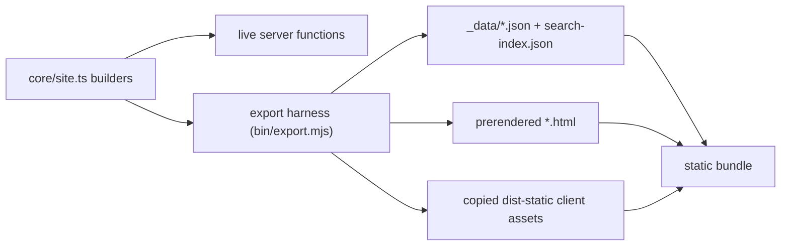

# Static Site Generation

<!-- Component type: library -->
<!-- Path: apps/wiki (export harness + data-source seam) + packages/diffwiki-core/src/site.ts -->

## Overview

Static site generation exports every collection as a self-contained bundle — pre-rendered pages, hashed assets, JSON data, and a client-side search index — that runs on a dumb file host such as GitHub Pages with no process at runtime. It lives across the wiki app (the export harness and the build-time data seam) and the core package (the shared page/navigation builders). Without it the knowledge base can only be browsed through a running local server, so it could never be published for others to read.

## Requirements

- Must produce a bundle that renders every collection, article, and folder listing with no server at runtime — a plain file host serves it verbatim.
- Must reuse the live application's React interface (sidebar, table of contents, theme, article rendering) rather than a second interface, so the static output does not drift from the live one.
- Must keep the live server-side-rendered (SSR) application unchanged: the static behaviour is selected only at build time.
- Must degrade search to an offline client-side match (no server), and must omit live git branch information, emitting a console warning for each affected collection.
- Must support deployment under a configurable base path (a GitHub Pages project sub-path), prefixing every asset and route URL.

## Design

### Build-time data seam

The live application loads all data through `createServerFn` handlers that run on Node. A static host has no Node process, so a single module — `apps/wiki/src/lib/data-source.ts` — selects the data implementation at build time from the `VITE_DIFFWIKI_STATIC` environment variable. Live builds delegate to the server functions unchanged; static builds fetch pre-generated JSON. Because the switch is a compile-time constant, the unused branch is tree-shaken, so the static client bundle contains no server-function code.

### One set of builders

The canonical page and navigation logic lives once in `packages/diffwiki-core/src/site.ts`. Both the live server functions and the export harness call the same builders, so a single implementation feeds live browsing, static prerendering, and static client navigation — there is no duplicated rendering path to drift.

### Prerender through the built server bundle

Rather than adopt a framework prerender crawler, the harness drives the built server bundle's own `fetch` handler for each route and captures the streamed markup. A fetch shim resolves `_data/` requests from the local file system during prerender, so no HTTP server is needed. This reuses the exact same code path the production server uses, which keeps the prerendered markup hydratable by the shipped client bundle.

## Implementation

### Public API Surface

The static path is assembled from three seams:

| Seam | Location | Role |
|------|----------|------|
| `loadNavTree` / `loadCollections` / `loadPage` | `apps/wiki/src/lib/data-source.ts` | Build-time-switched loaders the route loaders call; live → server functions, static → `${BASE_URL}_data/` JSON. |
| `buildNavTree` / `buildCollections` / `resolvePage` / `toTreeNodes` | `packages/diffwiki-core/src/site.ts` | Shared builders producing `CollectionTree[]`, `CollectionInfo[]`, and `PageData`. The thin app server functions (`server/collections.ts`, `server/doc.ts`) only wrap these. |
| Export harness | `apps/wiki/bin/export.mjs` | Node script that assembles the bundle (steps below). |

### Export flow

1. Emit `_data/` — call `buildNavTree`, `buildCollections`, and `resolvePage` for every route and write each result as JSON under `<out>/_data/`.
2. Emit `search-index.json` — call `buildSearchIndex` (core) and write the flat document array to the output root.
3. Copy client assets — copy the `dist-static/` Vite output (bundles, styles, hashed assets, `public/`) into `<out>`.
4. Prerender pages — for each route, call the built server bundle's `fetch` handler with the on-disk `_data` shim and write the returned markup to `<out>/<route>/index.html`.
5. Emit `.nojekyll` — so GitHub Pages serves `_data/` paths and hashed filenames verbatim.

The harness is reached through `apps/wiki/bin/wiki-server.mjs` when its first argument is `export`, mirroring how the app is spawned to serve; the command-line interface's `diffwiki export` spawns it the same way `diffwiki up` spawns the live server. Production builds (`mise run build`) also produce `apps/wiki/dist-static/`, shipped in the published package so `diffwiki export` works from an installed copy without a development environment.

### Selecting collections

`diffwiki export` exports every registered collection by default. `--filter <globs>` (allowlist) and `--exclude <globs>` (denylist) narrow that set — each is a comma-separated list of name globs (`*`, `?`), applied as filter-then-exclude. The selection is resolved by the pure `resolveCollectionSelection` (core), and it is **validated upfront**: a pattern that matches no collection, or a selection that ends up empty, aborts the command **before anything is generated** (the CLI checks before even spawning the app). The chosen set filters the nav tree (sidebar), `collections.json` (home pills), `search-index.json` (search), and the emitted routes/`_data/doc` — so excluded collections are absent everywhere, including search.

### Environment Variables / Configuration

| Variable | Description | Required |
|----------|-------------|----------|
| `VITE_DIFFWIKI_STATIC` | Set to `1` at build time to select the static data-source branch and disable live-reload. | no (default: live) |
| `DIFFWIKI_STATIC` | Set to `1` at export time to make core omit git branch status (with a per-collection console warning). | no |
| `DIFFWIKI_BASE` | Base URL path baked into the bundle (`vite base`); the router reads it as `import.meta.env.BASE_URL`. Pass a project sub-path such as `/my-repo/`. | no (default: `/`) |

## Deviations from the live app

A static build renders the same React shell and layout as the live app (see [`app-shell.md`](app-shell.md)), but a few behaviours change because there is no server at runtime. All are gated by the build-time `VITE_DIFFWIKI_STATIC` / export-time `DIFFWIKI_STATIC` flags, so the live app is unaffected.

| Area | Live app | Static export |
|------|----------|---------------|
| Data loading | Route loaders call `createServerFn` RPCs | Loaders fetch pre-generated JSON under `${BASE_URL}_data/` (the `data-source` seam) |
| Search | `/search` runs native BM25 **or** a plugin engine (qmd / ripgrep) on the server | Same `/search` page, but it runs the **same** native BM25 (`rankDocs`) client-side over `search-index.json`; plugin engines are server-only (no mode dropdown) |
| Sidebar git badges | External collections show branch + "behind remote" | Omitted (git state is unavailable); the exporter logs a `console.warn` per affected collection |
| Live reload | `/api/watch` SSE + chokidar re-render on file change | Compiled out — no server, content is frozen at export time |
| Base path | Served at `/` | Prefixed with `--base` (`DIFFWIKI_BASE`); assets and `_data` URLs are rewritten |

The layout itself (three responsive layouts, gutters, TOC placement) is identical to the live app — the shell is prerendered as-is and hydrates.

## References

- `apps/wiki/bin/export.mjs` — the export harness (emit data, copy assets, prerender).
- `apps/wiki/src/lib/data-source.ts` — build-time data seam.
- `packages/diffwiki-core/src/site.ts` — shared navigation and page builders.
- `mise-tasks/export` — one-step task: static Vite build then harness run.
- [`docs/architecture/search.md`](search.md) — the static search index consumed by the exported site.
- [`docs/architecture/collections.md`](collections.md) — the collection model the exporter enumerates.
- [TanStack Start](https://tanstack.com/start) — the underlying SSR framework whose `fetch` handler the harness drives.
