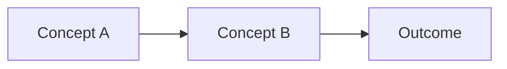

<!--
Use this shape to teach. A guide explains the reasoning, trade-offs, and mental model behind a set of related patterns. It answers "why" and "how does this fit together" — not "what steps do I follow". If the reader needs a procedure, use recipe-with-steps. If they need a lookup, use reference.

Authoring rules:
  - Adhere to the template structure
  - One H2 per concept or insight; each section covers one idea
  - State trade-offs and limits, not just the happy path
  - Show, don't tell: replace prose explanations with Mermaid diagrams, tables, and code examples wherever possible. A sequence diagram beats three paragraphs of data-flow description. A comparison table beats a list of trade-offs.
  - Soft-wrap prose
  - Use inline references as needed for other wiki articles and external sources
  - Do not copy over html comments or the template specific yaml frontmatter above this section. Write a diffwiki article yaml frontmatter as shown below this comment.
  - Use concise descriptive titles in article frontmatter
  - Tag programming languages, frameworks, topics of relevance to support vector embedding/search
  - Default to public audience and draft status unless user specifies otherwise
-->

---

title: TITLE
tags:

- guide
- TAG1
- TAG2
- ...
  audience: public
  status: draft

---

One to three sentences. State the insight or principle this guide teaches and name the concrete systems or patterns it covers. State what the guide does not cover and link to the adjacent recipe or reference: see [<related>](./<related>.md).

## <The core concept — concrete noun, not "Overview">

State what this concept is and why it matters. Name the constraint or trade-off that makes it non-obvious.

```<lang>
<illustrative example — under ~40 lines>
```

Explain what the example demonstrates. Point to the part that carries the lesson.

## <Second concept or pattern>

State how this concept relates to the previous one. Describe the trade-off or decision point a reader faces between the two.

If the relationship needs a diagram:



## <When this breaks / limits>

State the condition under which the pattern fails. One paragraph per failure mode. Link to the recipe that handles each case: see [<recipe>](../<collection>/<slug>.md).

## References

- [<Primary source>](<url>) — <one-line reason>
- [<Related recipe or guide>](../<collection>/<slug>.md) — <one-line reason>
