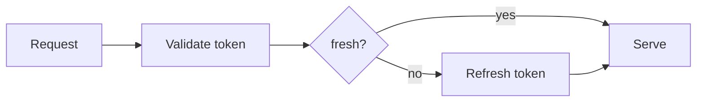
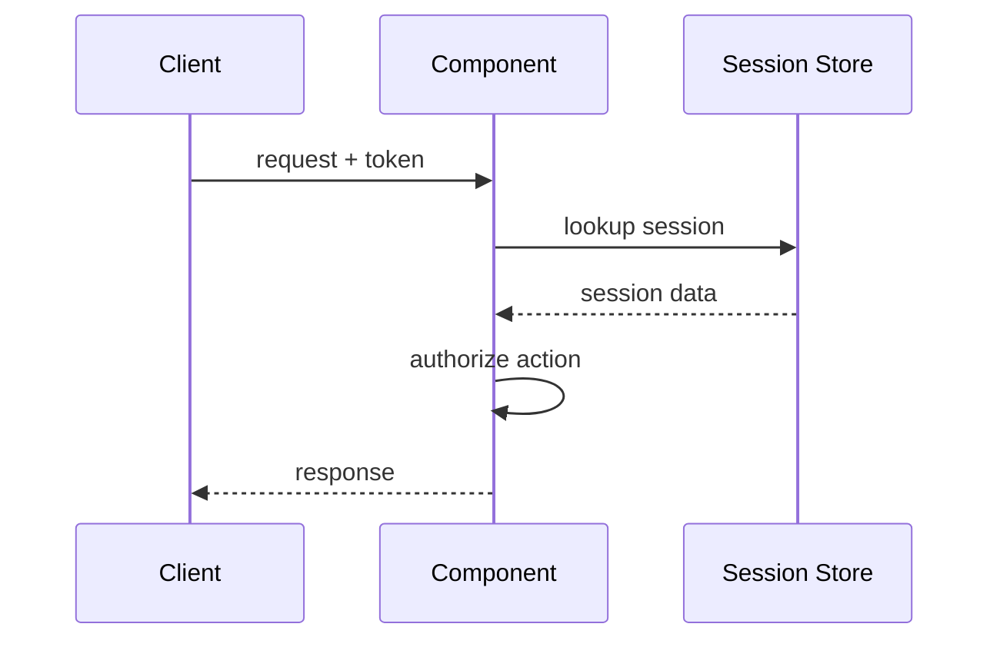

<!--
COMPONENT DESIGN DOC TEMPLATE. Copy this file into the target project's docs (usually `docs/architecture/components/<component>.md`), replace `<...>` placeholders, then swap `diffwiki-template` for the component slug — instance tags are always `[architecture, <component-slug>]`.

Structure follows the codevoyant `component-base.md` shape:
  - Intro prose — what this component is, where it lives, why it exists.
  - `## Overview` — 2–3 sentences answering what/where/why. Type and path noted in an HTML comment near the top.
  - `## Requirements` — measurable obligations. Not "how".
  - `## Design` — key decisions, WHY before WHAT. H3 per design concern.
  - `## Implementation` — flows, structure, configuration. H3 per major flow.
  - `## References` — source files, related architecture docs, external dependencies.

Authoring rules:
  - No class names, function names, or file paths in the intro prose (per language-guide convention). Save those for Implementation.
  - Define acronyms on first use.
  - Mermaid for every flow with 4+ steps; numbered list for shorter flows.
  - Inline links throughout.
  - Sections under ~900 tokens.
-->

<!-- Component type: <api | library | frontend | infra> -->
<!-- Path: <e.g. libs/auth, apps/web/src/routes/api/images> -->

One paragraph naming the component, where it sits in the system, and the concrete problem it solves. Link inline to the [system architecture](../architecture.md) and to any component this one directly depends on, like [`components/session-store.md`](./session-store.md).

## Overview

Two to three sentences answering, in order:

1. What is this component? What does it do?
2. Where does it live? What path in the codebase?
3. Why does it exist? What would break without it?

Avoid class names, function names, and file paths at this level — save concrete identifiers for the Implementation section. Define every acronym on first use.

## Requirements

What this component must do, expressed as measurable obligations. Not implementation details. Phrase each as "must", "must not", "returns", "rejects".

- <e.g. Must authenticate every request — unauthenticated callers receive 401.>
- <e.g. Must not store plaintext credentials — passwords are hashed with argon2id at rest.>
- <e.g. Returns within 200 ms P95 under normal load.>
- <e.g. Rejects requests larger than 10 MB with 413.>

## Design

Key decisions. WHY before WHAT. Every non-obvious choice gets a rationale sentence, either inline or in a "Why" callout below the decision.

### <Key design concern — e.g. Session Format>

Describe the decision. Explain why it was made — trade-offs considered, what got ruled out.

For three or more related properties, use a table:

| Property           | Value                    | Rationale |
|--------------------|--------------------------|-----------|
| <property>         | <value>                  | <why>     |
| <property>         | <value>                  | <why>     |

For multi-step behavior, use a Mermaid diagram:



### <Second design concern — e.g. Data Model>

Same shape. Include a diagram or table when it clarifies more than prose.

### <Third design concern — e.g. Security Properties>

<...>

## Implementation

### <Major flow — e.g. Authentication Flow>

Sequence diagram for flows with four or more steps; numbered list for shorter flows. Prefer the diagram when the flow crosses component boundaries.



Or, for a shorter flow:

1. <step description — active voice, present tense>
2. <step description>
3. <step description>

### File structure

```
<path>/
├── <file>          # <what this file does>
├── <file>          # <what this file does>
└── <subdir>/
    └── <file>      # <what this file does>
```

### Environment variables

Only include if the component has runtime configuration. Delete this section otherwise.

| Variable         | Description                   | Required |
|------------------|-------------------------------|----------|
| `<VAR_NAME>`     | <what it controls>            | yes      |
| `<VAR_NAME>`     | <what it controls>            | no       |

### Configuration files

Only include if the component reads config from disk beyond env vars.

| Path                     | Format | Purpose |
|--------------------------|--------|---------|
| `<path/to/config.yml>`   | YAML   | <what this configures> |

## References

- `<path/to/entry-point>` — <what this file does>
- `<path/to/another-file>` — <what this file does>
- [`components/<related>.md`](./<related>.md) — <why it's related>
- [`../architecture.md`](../architecture.md) — the system this component belongs to
- [<External library>](<url>) — <why referenced>
- [<Upstream spec>](<url>) — <why referenced>
