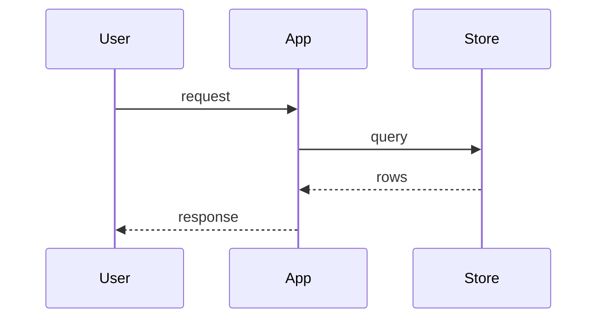

<!--
GUIDE TEMPLATE. Copy this file, replace `<...>` placeholders, then swap `diffwiki-template` for the topic slug — instance tags are always `[guide, <topic>]`.

Structure:
  - Intro prose — implicit load-when, no `**Load when:**` bold. One to three paragraphs. Human-readable.
  - H2 per section. Avoid H3 unless the section is genuinely a set of terse sub-cases (installation on different OSes, minor variants of one situation). If a subsection deserves more than a paragraph, it deserves its own guide or its own H2.
  - Inline links throughout — every mention of a related concept, tool, or upstream doc is a link. This helps qmd chunk quality because each chunk retains its own references.
  - Final `## References` — mandatory. Consolidated list of every source cited.

Authoring rules (see devtools/qmd/authoring-markdown):
  - One H2 per topic; each section ~900 tokens max.
  - Mermaid for all diagrams; never ASCII art.
  - Soft-wrap prose. Include synonyms for vector recall.
  - No bold `**Load when:**` prefix — the intro paragraph is discovery.
-->

Open with one to three paragraphs that state what this guide covers and who it's for, in prose a human reader can follow. Name the concrete tools, systems, or concepts the guide touches — this doubles as the implicit load-when trigger. Include inline links to the primary tools (like [SvelteKit](https://kit.svelte.dev/) or [Terraform](https://www.terraform.io/)) and to closely related guides in the wiki.

A second paragraph is fine when the guide spans a broad topic. Use it to state scope: what this guide does *not* cover, and where a reader should go for the adjacent topics. Link to sibling guides such as [`<related-guide>`](./<related-guide>.md) so a reader who lands here by mistake can bounce.

## <First section — a concrete topic, not "Overview">

Prose paragraph or two. Every proper noun and concept links inline: [React 19](https://react.dev/), [pnpm workspaces](https://pnpm.io/workspaces), the [pnpm-workspace recipe](../typescript/pnpm-workspace.md). Inline linking is deliberate — qmd chunks retain their references, so a retrieved chunk still points a reader to the sources.

If the section has more than ~600 tokens of prose, add a diagram, table, or code block to break the flow — retrieval prefers structured content over walls of text.


## <Second section>

Same shape. Prose plus inline links plus, if useful, a diagram or code.

Cite the source for any non-obvious claim inline: "Bash's `set -e` doesn't propagate into subshells on the left side of `||` — see [`bash/argument-parsing`](../bash/argument-parsing.md) for the full pitfall list."

## <Third section>

<...>

## <Section with terse sub-cases — e.g. Installation>

When one section genuinely covers a small set of terse alternatives — an installation guide for three OSes, or the three flavors of one CLI flag — H3 subcases are appropriate. Keep each subcase short.

### macOS

```bash
brew install <tool>
```

### Debian / Ubuntu

```bash
sudo apt install <tool>
```

### Arch

```bash
sudo pacman -S <tool>
```

If a subcase needs more than a few lines of prose or its own diagram, promote it to a sibling H2 or its own guide.

## <Cross-cutting concern — auth, observability, config, etc.>

Guides often need to describe cross-cutting concerns that touch every previous section. Give each its own H2 rather than nesting under an existing one. Link back inline: "See the [data-flow section](#data-flow) above for where this lands."

## Data flow

Describe how data moves through the system. Prefer a Mermaid sequence diagram over prose:



## Deployment topology

Where the pieces run. What talks to what across process, container, or network boundaries. Link to related guides like [`<deployment-guide>`](./<deployment-guide>.md).

## References

- [<Primary tool or system>](<url>) — <one-line reason>
- [<Adjacent guide in the wiki>](./<adjacent>.md) — <one-line reason>
- [<Recipe cited in a section above>](../<collection>/<slug>.md) — <one-line reason>
- [<External doc>](<url>) — <one-line reason>
