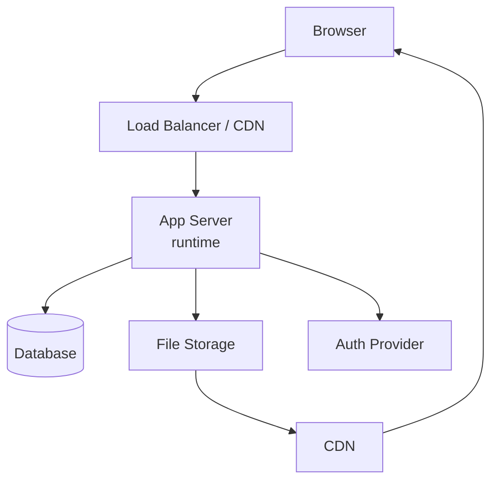
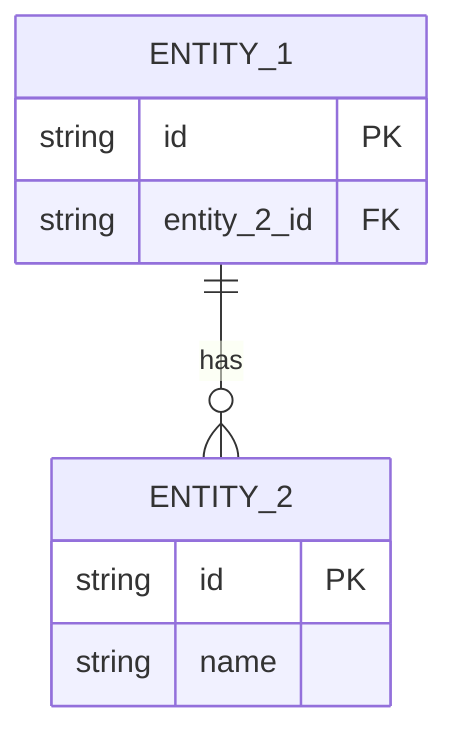
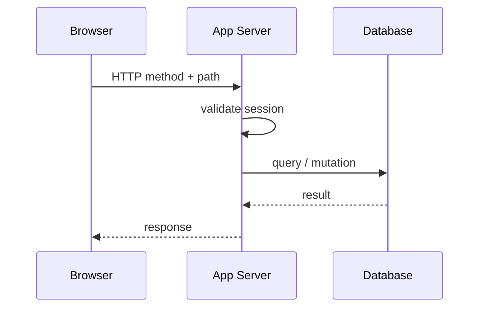
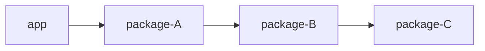
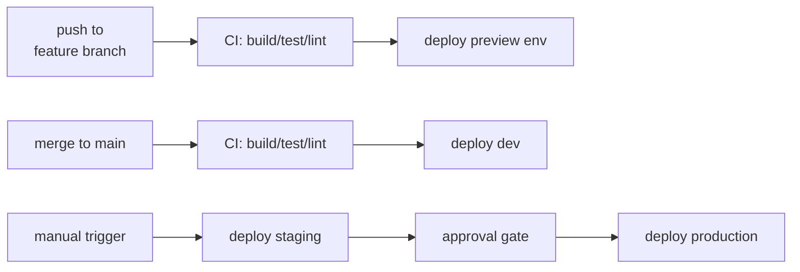

<!--
SYSTEM DESIGN DOC TEMPLATE. Copy this file into the target project's docs (or into `knowledge-base/<system>/architecture.md`), replace `<...>` placeholders, then swap `diffwiki-template` for the concrete system slug — instance tags are always `[architecture, <system-slug>]`.

Structure follows the codevoyant `architecture-readme.md` shape:
  - Intro prose paragraph — no bold `**Load when:**`. States what the doc covers.
  - `## Overview` — what the system is, top-level responsibilities, explicit non-goals. Includes a technology-stack table and a repository-structure block.
  - `## Requirements` — measurable properties. What success looks like. Not "how".
  - `## Design` — non-obvious decisions, system topology, data model, cross-cutting design concerns. Each subsection is an H3.
  - `## Implementation` — request lifecycle, dependency graph, infra layout, CI/CD.
  - `## References` — every component doc, library README, external doc worth linking.

Authoring rules (see devtools/qmd/authoring-markdown):
  - Mermaid for every diagram; no ASCII art.
  - Inline links throughout so chunks retain references.
  - Sections under ~900 tokens; split with H3 or `---` if longer.
-->

One prose paragraph naming the system, its purpose, and the reader it's written for. Link to the [component design docs](./components/) folder and to the [primary language guide](../<lang>/overview.md) if one exists.

## Overview

Two to three sentences. What is the system? What are its top-level responsibilities? What does it explicitly *not* do — the scoping statement matters as much as the inclusions.

### Technology stack

| Layer      | Choice     | Notes |
|------------|------------|-------|
| <layer>    | <choice>   | <optional note> |
| <layer>    | <choice>   | <optional note> |

### Repository structure

```
<project-root>/
├── <dir>/               # <what lives here — one-line description>
│   └── <subdir>/        # <if needed>
├── <dir>/               # <what lives here>
└── docs/
    └── architecture/    # this doc lives here
```

## Requirements

Measurable properties the system must satisfy. State each as an obligation, not an implementation detail. A new engineer should know what success looks like before reading Design.

- <e.g. All write operations are authenticated — unauthenticated requests return 401.>
- <e.g. Post content is served from CDN — P95 load time < 200 ms globally.>
- <e.g. Each environment (dev, staging, prod) is fully isolated — no shared state.>
- <e.g. All infrastructure changes go through Terraform — no console access in production.>

## Design

### Key principles

Four to six non-obvious decisions that shape how everything else is built. Include the "why" for each. These are the load-bearing choices future engineers will question.

- **<Principle 1>** — <what + why. Example: "Infra as code: all infrastructure in Terraform. Never use the cloud console — changes must be reviewable.">
- **<Principle 2>** — <what + why>
- **<Principle 3>** — <what + why>

### System topology

Major components and their connections.



### Data model

ER diagram for the four to six core entities. Deeper detail lives in the component design docs.



### Authentication

One or two sentences. Link inline to the component design doc: [`components/auth.md`](./components/auth.md).

### <Other major design concern — Environment Strategy, Multi-tenancy, ...>

Table or short prose for the concern. One H3 per concern.

| Environment | <key property 1> | <key property 2> |
|-------------|------------------|------------------|
| dev         | <value>          | <value>          |
| staging     | <value>          | <value>          |
| prod        | <value>          | <value>          |

## Implementation

### Request lifecycle



### Package / library dependency graph

Left-to-right flowchart. Consumers on the left, leaf packages on the right.



### Infrastructure layout

```
<infra-dir>/
├── <subdir>/    # <what this module provisions>
└── <subdir>/    # <what this module provisions>
```

### CI/CD

Push, merge, and deploy flow.



## References

- [`components/auth.md`](./components/auth.md) — authentication flow
- [`components/storage.md`](./components/storage.md) — file storage and CDN
- [`components/<component>.md`](./components/<component>.md) — <description>
- [`development-guide.md`](../development-guide.md) — local setup
- [<External doc>](<url>) — <one-line reason>
