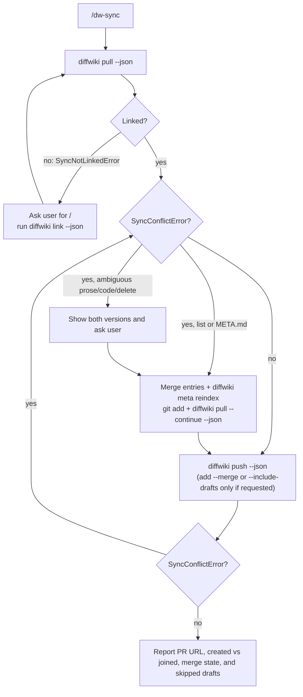

# dw-sync

Sync `~/.diffwiki` with your linked GitHub repository by pulling `origin/main` first and pushing `origin/user/<username>` second.



## Inputs

- Optional `--merge`: squash-merge the open pull request into `main` when conflict-free.
- Optional `--include-drafts`: include `status: draft` articles in the pushed commit.
- Optional `--prefer <remote|local|manual>`: select rebase conflict preference (default: `remote`).

## Steps

1. Pull upstream changes from `origin/main`:
   ```bash
   diffwiki pull --json
   ```
   - If the user passed `--prefer <side>`, append `--prefer <side>`.
   - If `SyncNotLinkedError` appears, ask the user for their GitHub `<owner>/<repo>` or repository URL, run `diffwiki link <repo> --json`, and rerun `diffwiki pull --json`.

2. Triage rebase conflicts when `SyncConflictError` stops a pull or push:
   - For non-contradictory list additions, tag unions, or generated `META.md` index sections, combine both sides, run `diffwiki meta reindex`, stage resolved files with `git -C ~/.diffwiki add <paths>`, and run `diffwiki pull --continue --json`.
   - For contradictory prose, code blocks, or modify/delete conflicts, show both sides to the user and ask which content to keep. Apply their choice, stage the file, and run `diffwiki pull --continue --json` (or run `diffwiki pull --abort --json` if the user cancels).

3. Push eligible changes and create or join the open pull request:
   ```bash
   diffwiki push --json
   ```
   - Pass `--include-drafts` only when the user asked to publish or sync drafts.
   - Pass `--merge` only when the user asked to merge in prose or passed `--merge`.
   - Repeated syncs push to `origin/user/<username>` and join the existing open pull request (`prCreated: false`). A new pull request opens only when none is open (`prCreated: true`).

4. Report the result:
   - State the branch, pull request URL, and whether the pull request was created or joined.
   - State whether the pull request merged into `main`.
   - List any draft files kept local (`excludedDrafts`).

## Rules

- Do not pass `--merge` unless the user asks to merge in prose or passes `--merge`.
- Do not pass `--include-drafts` unless the user asks to include drafts.
- Never hardcode a repository name. Always use the user's linked `origin` remote.
- Follow `references/technical-writing-guide.md` for all user-facing summaries.
